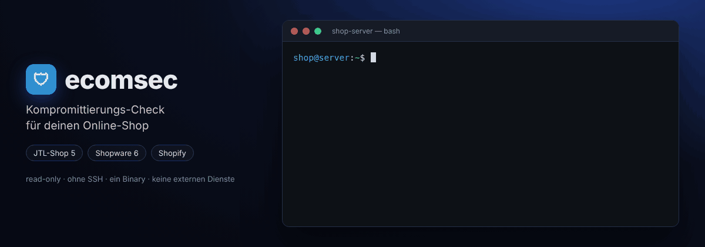
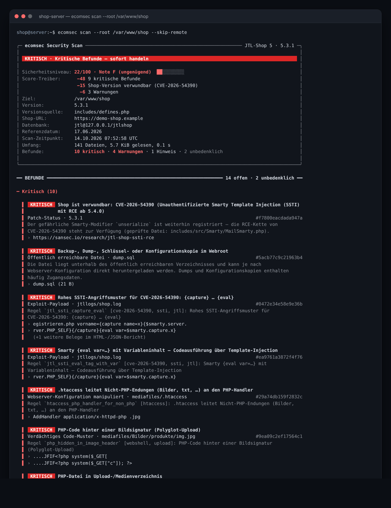
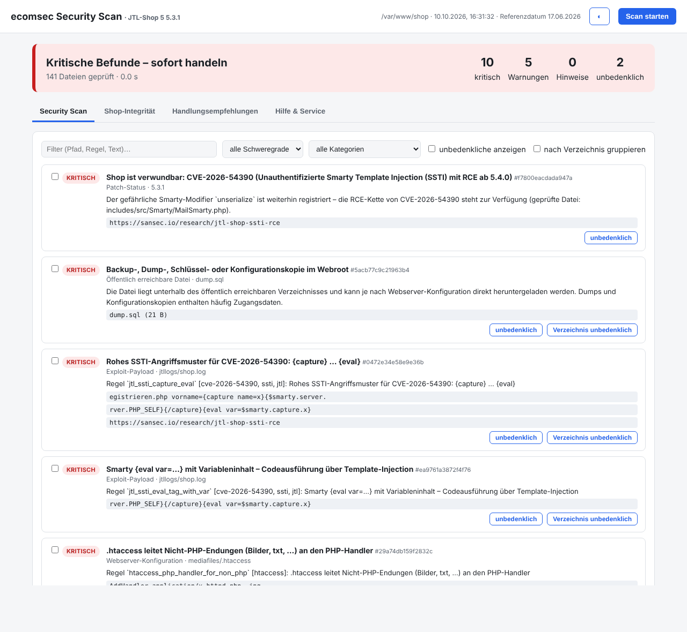
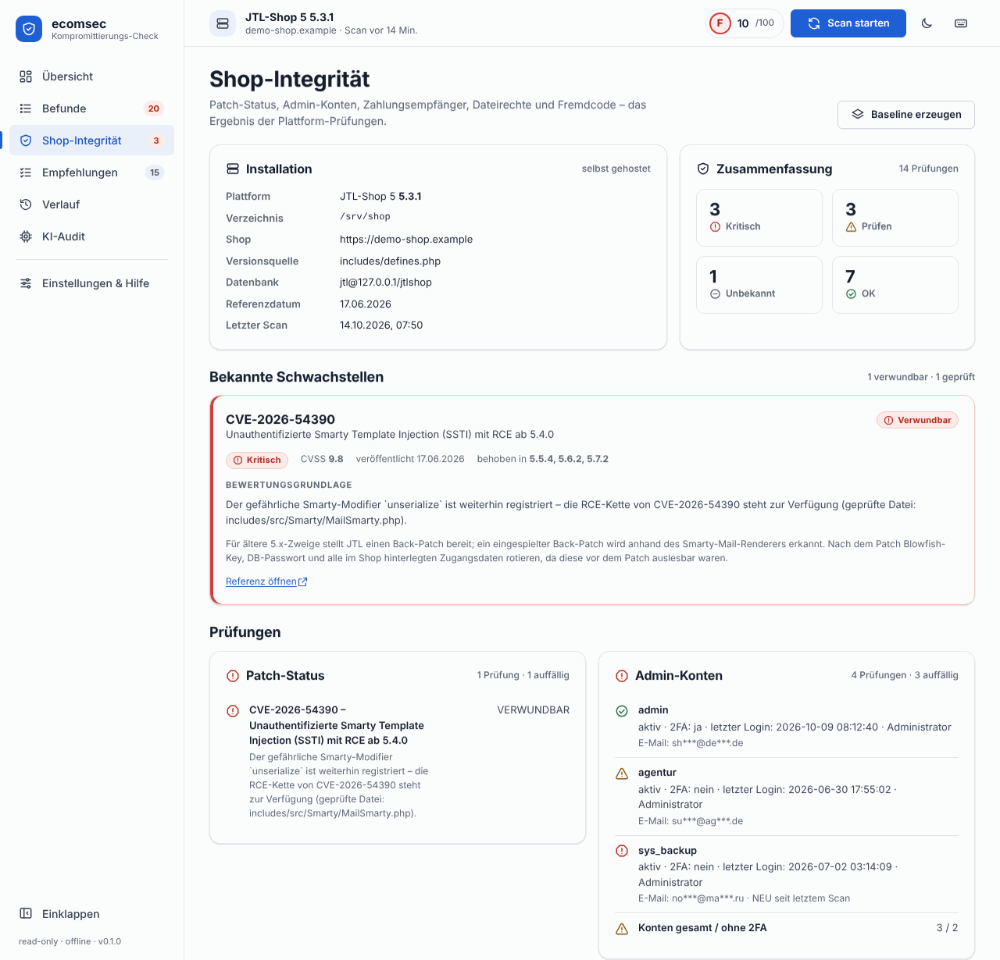
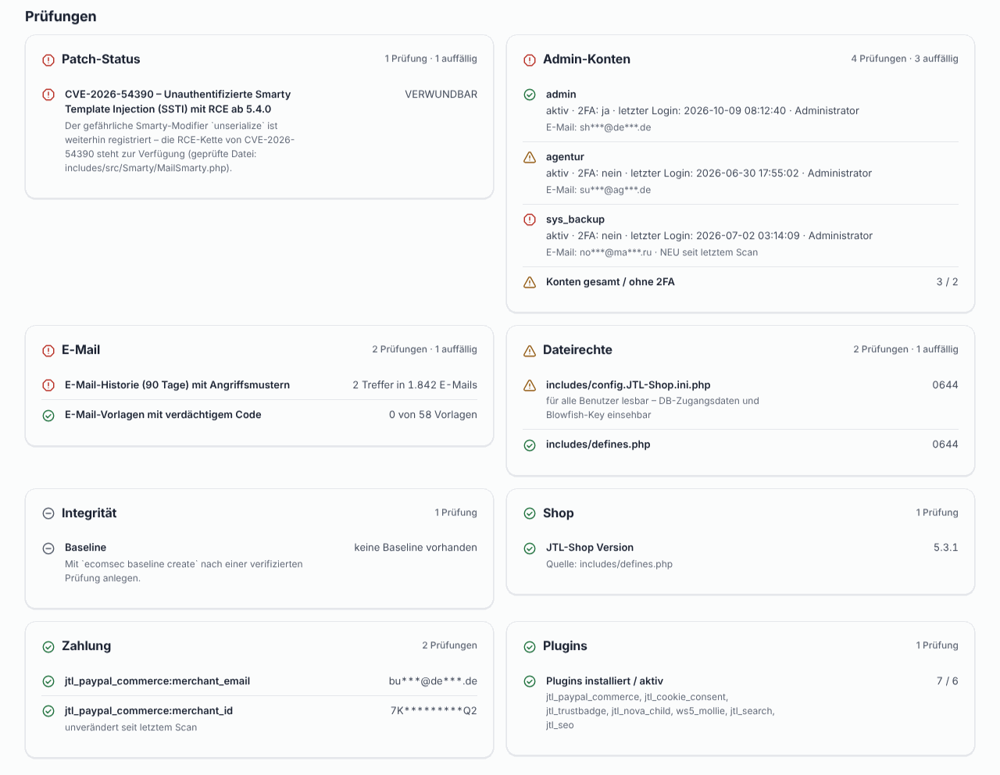
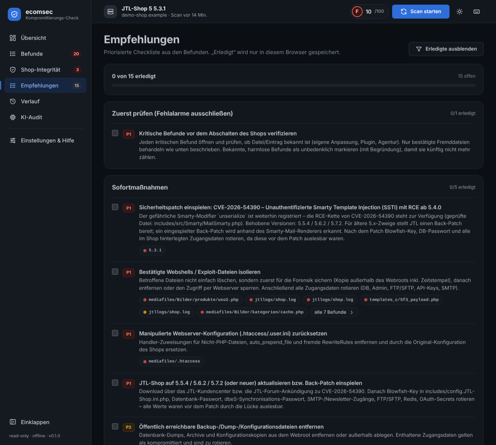

<p align="center">
  
</p>

<h1 align="center">ecomsec Security Scan</h1>

<p align="center">
  <b>Wurde mein Shop gehackt?</b> – In unter einer Minute Klarheit. Für JTL-Shop 5, Shopware 6, WooCommerce, Magento 2 und Shopify.
</p>

<p align="center">
  <a href="#-in-2-minuten-loslegen">Loslegen</a> ·
  <a href="#-das-bekommst-du">Funktionen</a> ·
  <a href="#-screenshots">Screenshots</a> ·
  <a href="#-häufige-fragen">FAQ</a> ·
  <a href="#-unterstützte-shopsysteme">Shopsysteme</a> ·
  <a href="docs/ARCHITECTURE.md">Für Entwickler</a>
</p>

<p align="center">
  
  
  
  
  
</p>

---

## 🔎 Was ist das?

`ecomsec` ist ein **Kompromittierungs-Check** für Online-Shops. Er durchsucht deine Installation
nach Spuren eines Angriffs – Webshells, Hintertüren, manipulierte Dateien, fremde Admin-Konten,
umgeleitete Zahlungen – und sagt dir in einer klaren Ampel, ob du handeln musst.

Entstanden ist das Werkzeug als Antwort auf die aktiv ausgenutzte Sicherheitslücke
**CVE-2026-54390** in JTL-Shop 5. Es prüft, ob dein Shop gepatcht ist **und** ob vorher schon
jemand drin war.

|   |   |
|---|---|
| ✅ **Nur lesend** | Es wird nichts verändert, nichts gelöscht, nichts nach außen gesendet. |
| ✅ **Ohne SSH, ohne Root** | Läuft überall, wo das Shop-Verzeichnis lesbar ist – auch auf Shared Hosting. |
| ✅ **Ein einziges Programm** | Keine Installation von PHP-Erweiterungen, Datenbanken oder Diensten. |
| ✅ **Verständliche Ergebnisse** | Drei Ansichten: *Security Scan*, *Shop-Integrität*, *Handlungsempfehlungen*. Deutsch, mit konkreten nächsten Schritten. |
| ✅ **Fehlalarme im Griff** | Bekannte, harmlose Befunde markierst du einmal als unbedenklich – sie zählen dann nie wieder mit. |

> **Wichtig:** Der Scan ist eine schnelle Triage-Hilfe. Ein kritischer Befund ist ein klares
> Warnsignal; ein sauberes Ergebnis ist keine Garantie. Bei bestätigtem Verdacht gehört eine
> forensische Analyse dazu.

---

## 🚀 In 2 Minuten loslegen

**1. Programm holen**

Fertiges Binary aus den [Releases](../../releases) laden – oder selbst bauen (benötigt [Rust](https://rustup.rs)):

```bash
cargo build --release
# → target/release/ecomsec
```

**2. Scan starten** (JTL-Shop 5, Shopware 6, WooCommerce/WordPress und Magento 2 werden automatisch erkannt)

```bash
ecomsec scan --root /var/www/shop
```

**3. Ergebnis lesen**

```
■ Kritische Befunde – sofort handeln
Befunde: 3 kritisch · 2 Warnungen · 0 Hinweise · 0 als unbedenklich markiert
```

| Ampel | Bedeutung | Was tun? |
|---|---|---|
| 🔴 **Kritisch** | Webshell, Exploit-Spur, ungepatchte Lücke, neues Admin-Konto, geänderter Zahlungsempfänger | Befund prüfen (Tab *Handlungsempfehlungen* › *Zuerst prüfen*), dann Sofortmaßnahmen |
| 🟡 **Warnung** | Geänderte Dateien, offene Dateirechte, Backups im Webroot, Konten ohne 2FA | Zeitnah prüfen, bekannte Fälle als unbedenklich markieren |
| 🟢 **Keine kritischen Befunde** | Alles im grünen Bereich | Wöchentlich wiederholen, Baseline anlegen |

**Mehr Komfort?** Das Dashboard im Browser starten:

```bash
ecomsec serve --root /var/www/shop
# → http://127.0.0.1:8787
```

---

## 🧰 Das bekommst du

### 1 · Security Scan – findet, was nicht in deinen Shop gehört

- **Bekannte Webshell-Namen** aus den IOC-Listen von CISA, NSA und MITRE (c99, r57, WSO, b374k, Alfa …) sowie typische Tarnungen wie `bild.jpg.php` oder versteckte `.dateien.php`
- **Neue oder geänderte PHP-Dateien** seit dem Referenzdatum (Standard: 17.06.2026, Veröffentlichung von CVE-2026-54390) – inklusive Erkennung **zurückdatierter Zeitstempel**
- **PHP in Upload- und Bilderverzeichnissen** – dort hat ausführbarer Code nichts verloren
- **Manipulierte `.htaccess` / `.user.ini`**, die Bilder als PHP ausführen oder Code in jede Seite einschleusen
- **Verdächtige Code-Muster** mit YARA-ähnlichen Regeln: `eval(base64_decode(…))`, China Chopper, Hex-Verschleierung, Reverse Shells, Dropper, Spam-Mailer, Karten-Skimmer
- **CVE-2026-54390-Angriffsmuster** (`{capture}…{eval}`, gefährliche Smarty-Modifier) in Dateien, kompilierten Templates und Logs
- **WordPress-/WooCommerce-Hintertüren** (versteckte Admin-Anlage, Login-Bypass, Must-Use-Plugins, Schein-Plugins, `.ico`-Loader) und **Magecart-Skimmer** in WooCommerce- und Magento-Checkouts, RequireJS-Konfigurationen und CMS-Inhalten
- **Öffentlich erreichbare Backups, Datenbank-Dumps und Konfigurationskopien**

### 2 · Shop-Integrität – ist dein Shop noch deiner?

- **Patch-Status** für CVE-2026-54390: zuerst anhand der Version (5.5.4 / 5.6.2 / 5.7.2 / ab 5.8), sonst anhand der geprüften Datei – das Ergebnis sagt immer, worauf es beruht
- **Patch-Status für WordPress, WooCommerce und Magento** inklusive Patch-Level (`2.4.6-p6`) – z. B. CosmicSting, SessionReaper, WP_Query-SQL-Injection, WooCommerce-Store-API
- **Zahlungs-, URL- und Script-Einstellungen in der Datenbank** (Head-/Footer-Scripts, `siteurl`, Basis-URLs, Webhooks, API-Schlüssel) mit Änderungserkennung zwischen zwei Scans
- **Admin-Konten** mit letztem Login und 2FA-Status; **neue Konten seit dem letzten Scan** werden kritisch gemeldet
- **PayPal-Empfängerkonto** (teilmaskiert) mit Änderungserkennung zwischen zwei Scans
- **E-Mail-Historie der letzten 90 Tage** auf eingeschleuste Angriffs-Payloads
- **E-Mail-Vorlagen, Kunden- und Kontaktdaten** mit Template-Syntax
- **Dateirechte** der Konfigurationsdatei, **Plugins und Cronjobs**, die nach dem Referenzdatum hinzukamen
- Optional eine **Baseline**: ein Fingerabdruck aller Kerndateien, gegen den spätere Scans vergleichen

### 3 · Handlungsempfehlungen – was jetzt zu tun ist

Eine priorisierte Checkliste in vier Gruppen: **Zuerst prüfen** (Fehlalarme ausschließen, bevor
der Shop abgeschaltet wird), **Sofortmaßnahmen**, **Kompromittierungs-Prüfung** und
**Langfristige Härtung** – jeder Punkt verweist auf die Befunde, die ihn ausgelöst haben.

### Außerdem

- **Risikoakzeptanz:** Befunde einzeln, pro Verzeichnis oder pro Regel als unbedenklich markieren, mit Begründung. Bleibt über alle künftigen Scans erhalten.
- **Berichte:** Terminal, JSON (für Monitoring) oder eine einzelne HTML-Datei zum Weitergeben.
- **Shared-Hosting-tauglich:** Mit `--time-budget 45s` scannt `ecomsec` in Etappen und setzt beim nächsten Aufruf fort – kein Timeout, keine Last.
- **Hell und dunkel:** Dashboard und HTML-Bericht folgen deinem System oder per Klick.
- **Scan-Verlauf:** Jeder Lauf wird mit Ergebnis gespeichert, damit du Veränderungen siehst.
- **Aktuelle Schwachstellen:** Die Advisory-Datenbank liegt als Datei im Repository, wird wöchentlich von einem Agenten nachgepflegt und lässt sich ohne neues Release per `ecomsec advisories update` holen. Mit `--online` prüft der Scan zusätzlich alle Composer-Pakete (Shopware-Core, Magento, Plugins, Symfony, Smarty …) tagesaktuell gegen OSV.dev und vergleicht WordPress-Plugins mit dem WordPress.org-Verzeichnis.

---

## 📸 Screenshots

<p align="center"></p>
<p align="center"><i>Scan im Terminal: Ampel, Zusammenfassung und Befunde mit Beweisausschnitten.</i></p>

<p align="center"></p>
<p align="center"><i>Dashboard, Tab „Security Scan“: Filter, Gruppierung nach Verzeichnis, Befunde einzeln oder gesammelt als unbedenklich markieren.</i></p>

<p align="center"></p>
<p align="center"><i>Tab „Shop-Integrität“: bekannte Schwachstellen mit Begründung des Patch-Status, Version, Baseline, Dateirechte.</i></p>

<p align="center"></p>
<p align="center"><i>Admin-Konten mit 2FA-Status, PayPal-Empfänger, E-Mail-Historie und Plugins (Beispieldaten).</i></p>

<p align="center"></p>
<p align="center"><i>Tab „Handlungsempfehlungen“ im dunklen Design: priorisierte Checkliste mit Verweis auf die auslösenden Befunde.</i></p>

---

## 🛒 Unterstützte Shopsysteme

| Shopsystem | Zugriff | Erkennung | Datenbank-/API-Prüfungen |
|---|---|---|---|
| **JTL-Shop 5** (5.0 – 5.8+) | Shop-Verzeichnis, optional MySQL | automatisch | Admin-Konten, PayPal, E-Mail-Historie, Vorlagen, Kundendaten, Plugins, Cronjobs |
| **Shopware 6** (6.4+) | Projekt-Verzeichnis, optional MySQL | automatisch | Benutzer, API-Integrationen, Apps/Plugins, Zahlungsanbieter, Mail-Templates, Flows, Snippets/CMS |
| **WooCommerce / WordPress** (WordPress 4.x+, WooCommerce 3.x+) | Webroot, optional MySQL | automatisch | Administratoren & Sitzungen, Standardrolle, siteurl/home, aktive Plugins, Options-/Beitrags-Injection, WP-Cron, PayPal/Stripe/BACS, REST-API-Schlüssel, Webhooks |
| **Magento 2 / Adobe Commerce** (2.3+) | Projekt-Verzeichnis, optional MySQL | automatisch | Admin-Benutzer & Sitzungen, Integrationen/OAuth, Basis-URLs, Head-/Footer-Scripts, Zahlungskonfiguration, CMS-Blöcke/-Seiten, Template-Direktiven, Cron-Jobs |
| **Shopify** | Admin-API-Token (nur Lese-Rechte) | `--platform shopify` | Script-Tags, Webhooks, Apps & Berechtigungen, Mitarbeiter (Plus), Live-Theme |

Die Datenbank-Zugangsdaten liest `ecomsec` aus der Shop-Konfiguration (`config.JTL-Shop.ini.php`,
`.env`, `wp-config.php` – auch eine Ebene über dem Webroot – bzw. `app/etc/env.php`). Ist keine Datenbank erreichbar, läuft der Dateiscan trotzdem vollständig – die
fehlenden Prüfungen werden im Bericht genannt.

```bash
# Shopify-Beispiel
ecomsec scan --platform shopify --shop mein-shop.myshopify.com --token shpat_…
```

Weitere Shopsysteme lassen sich als Adapter ergänzen – siehe [docs/ARCHITECTURE.md](docs/ARCHITECTURE.md).

---

## 🔁 Regelmäßig prüfen

Einmal pro Woche sowie nach jedem Update – so empfiehlt es auch das Original. Als Cronjob:

```cron
# jeden Montag 04:30 Uhr, Bericht als HTML, E-Mail nur bei kritischem Befund
30 4 * * 1  /usr/local/bin/ecomsec scan --root /var/www/shop --format html --output /var/backups/ecomsec-$(date +\%F).html || mail -s "ecomsec: kritischer Befund" admin@example.de < /dev/null
```

Exit-Codes: `0` sauber · `1` Warnungen (mit `--fail-on warning`) · `2` kritisch · `10` Fehler.

Auf Shared Hosting mit knappen Laufzeiten:

```bash
ecomsec scan --root /var/www/shop --time-budget 45s   # beim nächsten Aufruf geht es weiter
```

---

## 🧹 Fehlalarme ausräumen

Jeder Befund hat eine kurze ID. Was du kennst, markierst du einmal als unbedenklich:

```bash
ecomsec findings list   --root /var/www/shop
ecomsec findings accept --root /var/www/shop 5acb77c9c21963b4 --reason "Dump der Agentur, entfernt am 20.06."
ecomsec findings accept --root /var/www/shop --group templates_c --reason "kompilierte Templates"
ecomsec findings accept --root /var/www/shop --rule ctime_newer_than_mtime --reason "Deployment vom 01.10."
```

Im Dashboard geht das per Klick – einzeln, per Checkbox-Auswahl oder für ein ganzes Verzeichnis.

Nach einer verifizierten Prüfung lohnt sich eine Baseline. Spätere Scans melden dann jede
veränderte, fehlende oder neue Kerndatei:

```bash
ecomsec baseline create --root /var/www/shop
```

---

## ❓ Häufige Fragen

<details>
<summary><b>Verändert der Scan etwas an meinem Shop?</b></summary>
Nein. <code>ecomsec</code> liest ausschließlich – Dateien, Datenbank (nur SELECT) bzw. Shopify-API (nur GET). Es werden keine Dateien gelöscht, keine Einstellungen geändert und keine Daten an Dritte übertragen. Der einzige Schreibzugriff ist das eigene Zustandsverzeichnis (Akzeptanzen, Verlauf, Baseline), standardmäßig unter <code>~/.local/state/ecomsec</code>.
</details>

<details>
<summary><b>Ich habe einen kritischen Befund. Soll ich den Shop sofort abschalten?</b></summary>
Erst prüfen, dann handeln. Die Gruppe „Zuerst prüfen“ in den Handlungsempfehlungen führt dich durch: Ist die Datei bekannt (Agentur, Plugin, eigene Anpassung)? Dann als unbedenklich markieren. Ist sie fremd: sichern, entfernen, alle Zugangsdaten rotieren, Patch einspielen. Bei Datenabfluss gilt die 72-Stunden-Meldepflicht nach DSGVO Art. 33.
</details>

<details>
<summary><b>Warum werden so viele „geänderte Dateien“ gemeldet?</b></summary>
Alles, was nach dem Referenzdatum verändert wurde, ist erst einmal verdächtig – auch Updates und Agentur-Arbeiten. Setze das Referenzdatum auf deinen letzten bekannten sauberen Stand (<code>--reference-date 2026-09-01</code>) oder markiere die bekannten Verzeichnisse einmal als unbedenklich. Massenhafte Zeitstempel-Abweichungen durch ein Deployment fasst <code>ecomsec</code> automatisch zu einem Hinweis zusammen.
</details>

<details>
<summary><b>Woher weiß ecomsec, ob der CVE-2026-54390-Patch drin ist?</b></summary>
Zuerst anhand der Shop-Version (5.5.4, 5.6.2, 5.7.2 und ab 5.8 gelten als gepatcht). Bei älteren Versionen – oder wenn ein Back-Patch eingespielt wurde – prüft es die Smarty-Mail-Klassen: Sind die gefährlichen Modifier <code>unserialize</code>/<code>file_get_contents</code> noch registriert? Enthält der Renderer Härtungsmarker? Das Ergebnis nennt immer, ob die Version oder die Datei die Grundlage war.
</details>

<details>
<summary><b>Findet das Tool auch neue CVEs für Shopsysteme und Plugins?</b></summary>
Ja, auf drei Wegen. <b>1.</b> Die eingebaute Advisory-Datenbank (<code>advisories/*.toml</code>) wird wöchentlich automatisch aktualisiert: ein Workflow sucht in NVD und OSV.dev nach neuen Einträgen, ein Claude-Agent recherchiert Versionsbereiche in den Primärquellen und öffnet einen Pull Request, den ein Mensch freigibt. <b>2.</b> <code>ecomsec advisories update</code> lädt den aktuellen Stand, ohne dass du ein neues Release brauchst. <b>3.</b> <code>ecomsec scan --online</code> prüft alle Composer-Pakete deiner Installation (bei Shopware und Magento Core und Erweiterungen, bei JTL die mitgelieferten Bibliotheken) tagesaktuell gegen OSV.dev – dabei verlassen nur Paketnamen und Versionen den Server. Bei WordPress werden die installierten Plugins mit dem WordPress.org-Verzeichnis verglichen (nur der Plugin-Name wird gesendet). Für JTL-Plugins aus dem Extension Store, WordPress-Plugins außerhalb von WooCommerce und Shopify-Apps gibt es keine frei nutzbare Schwachstellen-Datenbank; hier bleibt die Risikobewertung nach Installationsdatum, Herkunft und Berechtigungen. Details: <a href="docs/ADVISORIES.md">docs/ADVISORIES.md</a>.
</details>

<details>
<summary><b>Brauche ich Datenbank-Zugang?</b></summary>
Nicht zwingend. Ohne Datenbank läuft der komplette Dateiscan, der Patch-Status und die Rechteprüfung. Admin-Konten, PayPal, E-Mail-Historie und Plugins benötigen die Datenbank; <code>ecomsec</code> nutzt dafür die Zugangsdaten aus der Shop-Konfiguration. Mit <code>--skip-remote</code> schaltest du diese Prüfungen bewusst ab.
</details>

<details>
<summary><b>Läuft das auf Shared Hosting?</b></summary>
Ja. Keine Root-Rechte, keine Dienste, ein statisch gebautes Binary. Mit <code>--time-budget</code> arbeitet der Scan in Etappen innerhalb der erlaubten Laufzeit und setzt beim nächsten Aufruf fort.
</details>

<details>
<summary><b>Kann ich eigene Regeln ergänzen?</b></summary>
Ja, als kleine TOML-Dateien im YARA-ähnlichen Format: <code>ecomsec scan --rules ./meine-regeln</code>. Anleitung in <a href="docs/RULES.md">docs/RULES.md</a>.
</details>

<details>
<summary><b>Was ist der Unterschied zum JTL-Plugin „EcomSec Security Scan“?</b></summary>
Gleicher Prüfumfang und gleiche drei Ansichten – aber als eigenständiges Programm statt als Plugin: läuft auch, wenn das Backend bereits kompromittiert ist, unterstützt mehrere Shopsysteme, liefert maschinenlesbare Berichte und lässt sich per Cron automatisieren.
</details>

---

## 💻 Systemvoraussetzungen

- Linux, macOS oder Windows (64-bit); Lesezugriff auf das Shop-Verzeichnis
- Für Datenbank-Prüfungen: MySQL/MariaDB-Zugang wie in der Shop-Konfiguration hinterlegt
- Für Shopify: Admin-API-Token mit Lese-Scopes (`read_script_tags`, `read_themes`, `read_apps`, `read_users`)
- Zum Selbstbauen: Rust ab 1.80

---

## ⚙️ Alle Befehle auf einen Blick

```
ecomsec scan      [--root PFAD | --platform shopify --shop … --token …]
                  [--format text|json|html] [--output DATEI] [--time-budget 45s]
                  [--reference-date YYYY-MM-DD] [--skip-remote] [--fail-on never|warning|critical]
                  [--online] [--advisories DIR]
ecomsec advisories list | lint [PFAD…] | update [--url BASIS-URL]
ecomsec serve     [--bind 127.0.0.1:8787] [--auth-token GEHEIM]
ecomsec findings  list | accept <ID…> [--group DIR] [--rule REGEL] [--reason TEXT] | unaccept <ID…> [--all]
ecomsec baseline  create [--core-only] | diff | show
ecomsec report    [--format text|json|html] [--output DATEI]
ecomsec history
ecomsec platforms
ecomsec rules     [--tag cve-2026-54390]
```

Optional per Konfigurationsdatei: [`ecomsec.example.toml`](ecomsec.example.toml).

---

## 🧑‍💻 Für Entwickler

- [docs/ARCHITECTURE.md](docs/ARCHITECTURE.md) – Aufbau, `Platform`-Trait, neue Shopsysteme anbinden
- [docs/RULES.md](docs/RULES.md) – Regelformat, Dateiklassen, Kategorien
- [docs/ADVISORIES.md](docs/ADVISORIES.md) – Schwachstellen-Datenbank, OSV-Abgleich, automatische Pflege per Agent
- Workspace: `ecomsec-core` (Engine), `ecomsec-jtl5`, `ecomsec-shopware6`, `ecomsec-woocommerce`, `ecomsec-magento2`, `ecomsec-shopify`, `ecomsec-osv`, `ecomsec-cli`
- `cargo test --workspace` · `cargo clippy --workspace --all-targets` · `cargo fmt --all`

## 📜 Lizenz und Hinweise

MIT-Lizenz. Signaturen und IOC-Listen stammen aus öffentlichen Quellen (CISA, NSA/ASD, MITRE ATT&CK,
Sansec-Analyse zu CVE-2026-54390) und erheben keinen Vollständigkeitsanspruch. Der dateibasierte
Patch-Nachweis ist eine Heuristik; Versionsbereiche der Advisories sind gegen die jeweiligen
Hersteller-Mitteilungen zu verifizieren; die Advisory-Datenbank unter `advisories/` wird automatisiert
aus NVD und OSV.dev gespeist und vor dem Merge geprüft. Dieses Projekt steht in keiner Verbindung zu JTL-Software,
Shopware AG, Shopify Inc., Automattic (WooCommerce), der WordPress Foundation oder Adobe (Magento).
